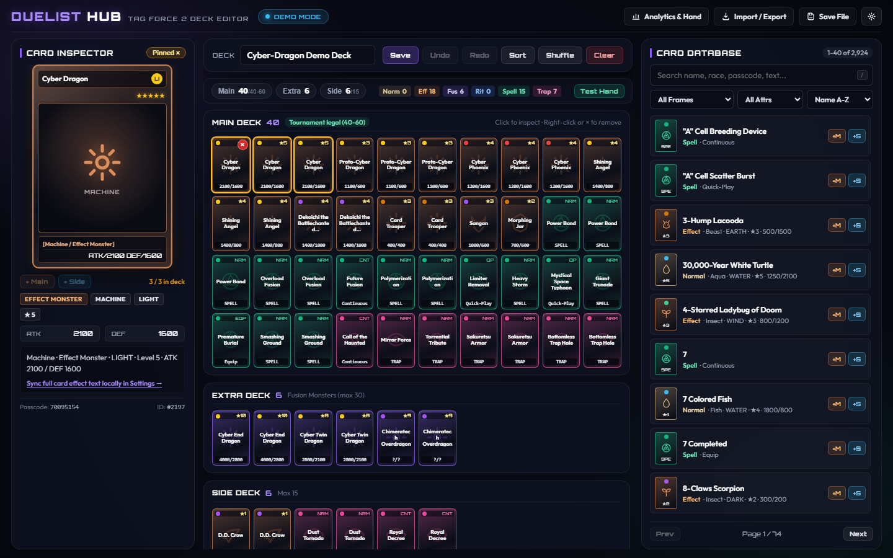
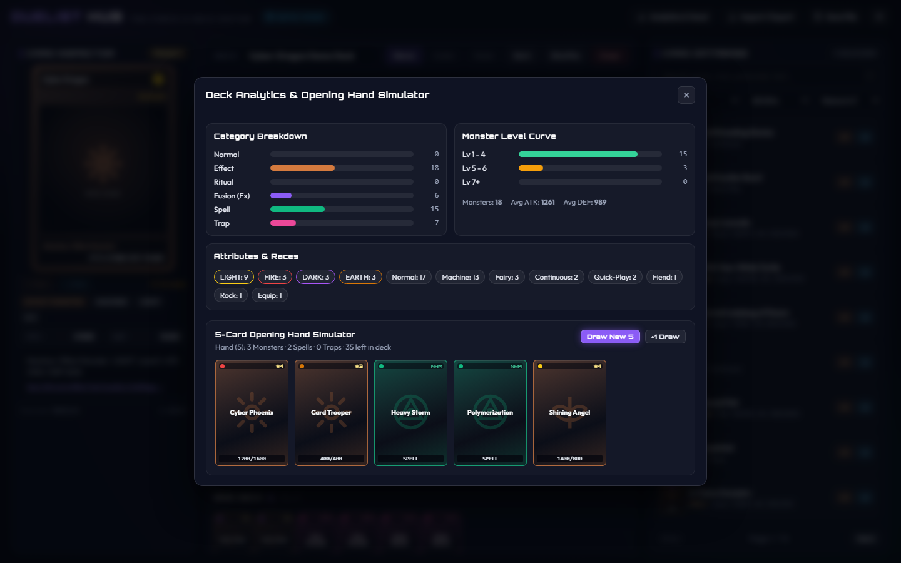
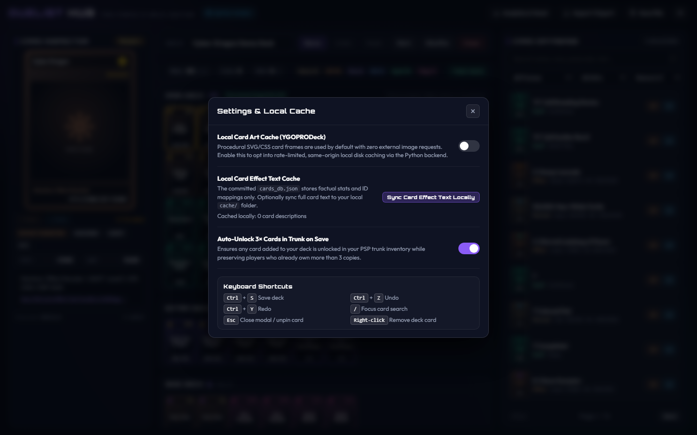

# 🎴 Duelist Hub — Yu-Gi-Oh! GX: Tag Force 2 Save File Deck Editor

[](https://www.python.org/downloads/)
[](LICENSE)
[](#)
[](#)

An open-source, zero-dependency web deck editor and save-file utility for **Yu-Gi-Oh! GX: Tag Force 2** (PSP / PPSSPP).

Read, edit, validate, and safely patch player decks directly into decrypted PPSSPP `DATA0` save files—or explore the entire **2,924-card Tag Force 2 catalog** right away in **Demo Mode** without needing a PSP save file.

---

## 📸 Preview

### Main Deck Editor — Default Cyber-Dragon Demo Deck


*Out of the box, Duelist Hub launches in Demo Mode with the bundled **Cyber-Dragon Demo Deck** (40 Main / 6 Extra / 6 Side), featuring the click-to-pin Card Inspector, live deck validity and category counters, and instant search across all 2,924 Tag Force 2 cards—rendered with clean procedural SVG/CSS card frames and zero external network requests.*

### Deck Analytics & 5-Card Opening Hand Simulator


*Inspect the Cyber-Dragon Demo Deck's category breakdown, monster level curve, average ATK/DEF, attribute/race distribution, and test live 5-card opening hands (+1 draw) using procedural card previews.*

### Settings & Opt-In Local Cache


*Privacy- and IP-first defaults: the **Local Card Art Cache** is off by default, **Local Card Effect Text** syncing is strictly opt-in, and **Auto-Unlock 3× Cards in Trunk on Save** keeps your PPSSPP inventory in sync without downgrading existing ownership.*

---

## 🛡️ Clean-Room & Zero Copyright Infringement

Duelist Hub is built from the ground up as a **clean-room, IP-safe** open-source utility:

- **Zero Proprietary Game Assets or Code:** This repository contains **zero** Konami binaries, PSP ROMs/ISOs, `.ehp` archives, extracted textures (`.gim`/`.ehf`), or proprietary game code.
- **Zero Copyrighted Card Artwork or Verbatim Card Text:** No copyrighted *Yu-Gi-Oh!* card images and no verbatim flavor or effect text are stored anywhere in the repository.
- **100% Original Procedural Frames by Default:** Every card renders out of the box using original procedural SVG/CSS frames driven strictly by factual metadata (`cards_db.json`: game index, passcode, name, frame type, attribute, level, race, and ATK/DEF). Optional artwork and card text are **strictly opt-in**—either via the local rate-limited disk cache (YGOPRODeck ToS-compliant, never hotlinked) or by pointing `TAGFORCE_ART_DIR` to your own local image folder.
- **Clean-Room Save Documentation:** All save-file layouts in `explainer.md` and `tagforce_save.py` are clean-room structural offset documentation for editing **user-owned, decrypted PPSSPP saves**.

---

## ⚡ Features

- **Zero External Dependencies:** Pure Python 3 standard library backend (`tagforce_save.py`, `card_cache.py`, `run_showcase.py`, `extract_deck.py`) and vanilla HTML/CSS/ES6 frontend—no `pip install` or build step required.
- **Instant Demo Mode & Browser Save Upload:** Launches seamlessly in **Demo Mode** (`sample_deck.json`) whenever no local PPSSPP save is present (or with `--demo`), and even works as a static web app with `localStorage` persistence. When running locally, you can also upload a `DATA0` save file directly in the browser, edit it, and download the patched `DATA0`.
- **IP-Safe Procedural Card Frames (Default):** Renders crisp, information-rich SVG/CSS card frames for Normal, Effect, Fusion, Ritual, Spell, Trap, and Anime-only cards displaying card name, frame type, attribute, level stars, race/subtype, and ATK/DEF.
- **Opt-In Local Artwork & Text Caching (YGOPRODeck ToS-Compliant):**
  - Never hotlinks external image servers.
  - Enable **Local Card Art Cache** in Settings to download each image **once** through the local Python proxy (strictly rate-limited at ≤ 10 req/s) and serve it permanently from `.gitignore`d `cache/`.
  - Or point `TAGFORCE_ART_DIR` at your own local card image pack (e.g., an EDOPro/YGOPro `pics/` folder).
  - Optionally sync card effect text locally via Settings (**Sync Card Effect Text Locally**) or `python card_cache.py --sync-text`, keeping the repository's `cards_db.json` strictly limited to factual stats and ID mappings.
- **Cross-Platform Save Discovery (EU & US):** Automatically locates PPSSPP saves for both Europe (`ULES00925`) and US (`ULUS10287`) across Windows (`Documents/PPSSPP`, `AppData/Roaming/PPSSPP`), Linux (`~/.config/ppsspp`), and macOS (`~/Library/Application Support/PPSSPP`), or via `--save`, `TAGFORCE_SAVE_PATH`, or `PPSSPP_SAVEDATA`.
- **Safe Binary Patching, Inventory Diffing & Rotating Backups:**
  - Structural deck-offset validation ensures renamed decks never break offset detection.
  - Smart inventory diffing at `0x13F11` clears stale counts for removed cards and preserves trunk ownership (never downgrading players who already own more than 3 copies; optional `Auto-unlock 3x in Trunk` toggle).
  - Atomic writes (`os.replace`), an immutable `DATA0.original.bak` created on first write, up to 10 rotating timestamped backups (`DATA0.YYYYMMDD_HHMMSS.bak`), and one-click restore in the UI.
- **Rich Deck Building UX:**
  - Click-to-pin Card Inspector, debounced search with Frame/Attribute filters & sorting (`Name`, `ATK`, `DEF`, `Level`), and live `x/3` in-deck copy badges.
  - **Deck Analytics & 5-Card Opening Hand Simulator** (type breakdown, Level/Attribute curves, interactive test hand + draw).
  - **Import / Export** standard `.ydk` (YGOPro/EDOPro passcode format), `.json`, and plain-text decklists.
  - Non-blocking toast notifications with quick Undo, safer card removal (`×` button or right-click), and full keyboard shortcuts.

---

## 🚀 Quick Start

### Prerequisites
- [Python 3.8+](https://www.python.org/downloads/) (on Windows, check **"Add Python to PATH"** during installation).
- *(Optional, for editing real saves)* [PPSSPP Emulator](https://www.ppsspp.org/) with a decrypted *Yu-Gi-Oh! GX: Tag Force 2* save (`DATA0`).

### Launching the Editor

1. **Windows (One-Click):**
   Double-click `start.bat` (or pass flags like `start.bat --demo`).
2. **Command Line (Windows / Linux / macOS):**
   ```bash
   # Auto-detect PPSSPP save (falls back to Demo Mode if none found)
   python run_showcase.py

   # Force Demo Mode with sample_deck.json
   python run_showcase.py --demo

   # Specify an explicit save file, host, port, or disable auto-opening the browser
   python run_showcase.py --save /path/to/DATA0 --host 127.0.0.1 --port 8000 --no-browser
   ```
3. Open `http://127.0.0.1:8000` in your browser (if port `8000` is busy, the server automatically selects the next available port).

### CLI Utilities

- **Extract a save file's deck from the command line:**
  ```bash
  python extract_deck.py --save /path/to/DATA0 --out-json deck.json --out-md deck.md
  ```
- **Optionally cache card effect descriptions locally:**
  ```bash
  python card_cache.py --sync-text
  ```

### Environment Variables

| Variable | Description |
| :--- | :--- |
| `TAGFORCE_SAVE_PATH` | Explicit path to your decrypted `DATA0` save file. |
| `PPSSPP_SAVEDATA` | Custom PPSSPP `SAVEDATA` directory to scan for `ULES00925*` / `ULUS10287*`. |
| `TAGFORCE_PORT` | Default HTTP server port (default: `8000`). |
| `TAGFORCE_ART_DIR` | Local folder of user-supplied card images (`<passcode>.jpg` or `<passcode>.png`). |

---

## ⌨️ Keyboard Shortcuts

| Shortcut | Action |
| :--- | :--- |
| `/` | Focus card search bar |
| `Ctrl+Z` | Undo last deck change |
| `Ctrl+Y` / `Ctrl+Shift+Z` | Redo deck change |
| `Ctrl+S` | Save deck |
| `Esc` | Close open modal or unpin inspected card |

---

## 🔓 How to Decrypt PPSSPP Save Files

By default, PSP saves are encrypted (`~PSP` / `QfNO` header). Duelist Hub reads and writes **decrypted `DATA0` saves**:

1. Open **PPSSPP** → **Settings** → **System** → **Savedata** (or **Developer tools**).
2. **Disable / uncheck `Encrypt Save`**.
3. Launch *Yu-Gi-Oh! GX: Tag Force 2*, load your save, and save in-game (e.g., sleep in your dorm bed or edit/save your trunk).
4. PPSSPP writes a decrypted `DATA0` file to your save folder:
   - **Windows:** `%USERPROFILE%\Documents\PPSSPP\PSP\SAVEDATA\ULES009250001\DATA0` (or `ULUS102870001` for US)
   - **Linux:** `~/.config/ppsspp/PSP/SAVEDATA/ULES009250001/DATA0`
   - **macOS:** `~/Library/Application Support/PPSSPP/PSP/SAVEDATA/ULES009250001/DATA0`

*(If Duelist Hub detects an encrypted save, it stays safely in read-only Demo Mode and displays an encrypted-save warning banner.)*

---

## 📁 Repository Structure

```text
TagForce2-DeckEditor/
├── tagforce_save.py        # Core save engine: ID mapping, offset validation, safe patching & backups
├── card_cache.py           # Opt-in local artwork/text cache & TAGFORCE_ART_DIR loader (rate-limited)
├── run_showcase.py         # Multi-threaded local HTTP server, strict file allowlist & REST API
├── extract_deck.py         # CLI wrapper to export a DATA0 deck to JSON / Markdown
├── start.bat               # Windows convenience launcher
├── index.html              # Duelist Hub web UI markup
├── index.css               # Dark cyberpunk stylesheet & procedural card frame styles
├── app.js                  # Frontend logic: search, filters, analytics, hand simulator, .ydk/.json I/O
├── cards_db.json           # Factual Tag Force 2 card metadata & ID mapping (2,926 slots; zero lore text)
├── sample_deck.json        # Bundled Demo Mode deck (Cyber-Dragon Demo Deck)
├── tests/
│   └── test_tagforce.py    # Unit & live HTTP integration test suite (synthetic DATA0 fixtures)
├── Screenshots/
│   ├── duelist_hub_demo.png      # Main Deck Editor (Cyber-Dragon Demo Deck, procedural frames)
│   ├── duelist_hub_analytics.png # Deck Analytics & 5-Card Opening Hand Simulator modal
│   └── duelist_hub_settings.png  # Settings & Opt-In Local Cache modal
├── explainer.md            # Deep-dive technical architecture & binary layout documentation
├── LICENSE                 # MIT License (applies to original source code)
└── README.md               # Project documentation
```

---

## 🧪 Running Tests

Run the full unit and live HTTP integration test suite (uses synthetic in-memory `DATA0` fixtures—no real save file or internet connection required):

```bash
python -m unittest discover -s tests -v
```

---

## 🛠️ Troubleshooting

| Issue | Solution |
| :--- | :--- |
| **"Save file is still encrypted"** | Disable **Encrypt Save** in PPSSPP, load your game, save from an in-game menu, then refresh or re-upload `DATA0`. |
| **"Demo Mode" shown instead of your save** | Pass `--save /path/to/DATA0`, set `TAGFORCE_SAVE_PATH`, or use the **Upload `DATA0`** button in the UI. |
| **Want card artwork or effect text** | Open **Settings** in the UI to opt into the local rate-limited cache, or set `TAGFORCE_ART_DIR` to your own local card image folder. |
| **Port 8000 already in use** | `run_showcase.py` automatically falls back to the next free port, or specify `--port 8080` / `TAGFORCE_PORT=8080`. |

---

## ⚖️ Legal Disclaimer & Attribution

- **Unofficial Fan Utility:** Duelist Hub is an independent, non-commercial, fan-made save-file utility. It is **not affiliated with, endorsed by, sponsored by, or supported by** Konami Digital Entertainment, Studio Dice, Shueisha, TV Tokyo, or Sony Interactive Entertainment.
- **Trademarks & Copyrights:** *Yu-Gi-Oh!* and all related titles, character names, and card artwork are trademarks and copyrights of their respective owners (© Studio Dice / SHUEISHA, TV TOKYO, KONAMI).
- **Zero Proprietary Assets Included:** This repository contains **zero** Konami ROM files, `.ehp` archives, extracted `.bin`/`.gim`/`.ehf` game binaries, or copyrighted card artwork. `cards_db.json` stores only factual interoperability mappings and numeric stats. Users must supply their own legally dumped save files and any optional local image packs.
- **YGOPRODeck API Attribution:** The optional, user-initiated local artwork and card-text cache uses the [YGOPRODeck API](https://ygoprodeck.com/api-guide/). To comply with YGOPRODeck's terms of use, Duelist Hub **never hotlinks** images directly from the browser—each requested asset is downloaded at most once through a rate-limited local proxy and cached on the user's own disk.
- **License Scope:** The [MIT License](LICENSE) in this repository applies strictly to the original source code and documentation authored for this project, and does not grant rights to any third-party trademarks or intellectual property.
